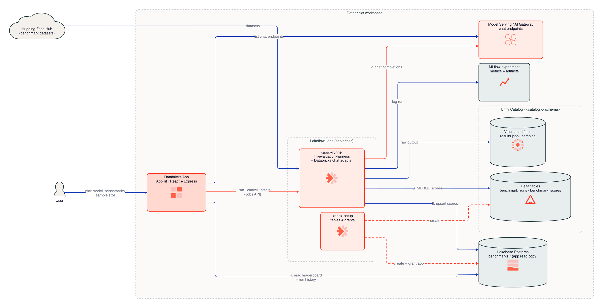

# LLM Benchmarks on Databricks

Benchmark any chat model served on Databricks — Foundation Model APIs, external models behind
AI Gateway, or your own Model Serving endpoints — against standard open-source benchmarks, and
compare every new model with the ones you tested before.

A Databricks App lets you pick a model and the benchmarks to run. A serverless job runs
[EleutherAI lm-evaluation-harness](https://github.com/EleutherAI/lm-evaluation-harness) against
the endpoint, stores scores in Delta and Lakebase, logs them to MLflow, and the app shows a
leaderboard and side-by-side comparison.

```bash
./deploy.sh --profile <databricks-cli-profile> --catalog <existing-catalog>
```

---

## Contents

- [Features](#features)
- [Architecture](#architecture)
- [Benchmarks](#benchmarks)
- [Prerequisites](#prerequisites)
- [Quick start](#quick-start)
- [Deployment options](#deployment-options)
- [What gets created](#what-gets-created)
- [Using the app](#using-the-app)
- [How scoring works](#how-scoring-works)
- [Data model](#data-model)
- [Security and identity](#security-and-identity)
- [Cost](#cost)
- [Adding a benchmark](#adding-a-benchmark)
- [Local development](#local-development)
- [Updating, multiple deployments and teardown](#updating-multiple-deployments-and-teardown)
- [Troubleshooting](#troubleshooting)
- [Project structure](#project-structure)
- [Design notes](#design-notes)

---

## Features

- **Any chat endpoint**: the model picker lists every `READY` serving endpoint with the
  `llm/v1/chat` task in the workspace.
- **8 benchmarks suited to new frontier models**: MMLU-Pro, GPQA Diamond, IFEval, BIG-Bench Hard,
  MATH-500, AIME 2025, GSM8K and HumanEval.
- **Sample sizes**: smoke test (10 per task), quick (50), standard (200) or the full benchmark.
- **Leaderboard**: a ranked list by overall score, top picks per skill area, a head-to-head view for
  any two models, and *too close to call* when a gap is within the margin of error.
- **Run history**: live status, cancel, links to the job run, sub-task scores, standard errors,
  token usage, and the request parameters each endpoint accepted.
- **Durable, queryable results**: Delta tables in Unity Catalog (source of truth), a Lakebase
  copy for fast app reads, MLflow runs, and raw lm-eval output with per-question logs in a UC volume.
- **One-command deploy and teardown** on any workspace.

## Architecture

<picture>
  <source media="(prefers-color-scheme: dark)" srcset="docs/architecture-dark.png">
  
</picture>

<sub>Source: [`docs/architecture.d2`](docs/architecture.d2) (D2, Databricks theme). Red edges are the benchmark hot path; dashed edges are one-time setup by the setup job.</sub>

1. You pick an endpoint, benchmarks and a sample size in the app.
2. The app's service principal triggers the `<app-name>-runner` job with those parameters (the app
   generates the run ID up front so it can track the run before the job writes anything).
3. The job probes the endpoint, runs each benchmark with lm-evaluation-harness through a Databricks
   adapter, and writes a `RUNNING` row, then scores, then the final status, to Delta and Lakebase.
4. The app reads results from Lakebase and in-flight run state from the Jobs API.

## Benchmarks

All benchmarks are *generative*: the model writes its answer and the harness extracts and checks
it. That's what lets them run against chat endpoints, which don't return log-probabilities.

| Key | Benchmark | Measures | lm-eval task | Headline metric | Questions |
|---|---|---|---|---|---|
| `mmlu_pro` | MMLU-Pro | Knowledge (14 subjects, 10 options) | `mmlu_pro` (5-shot CoT) | `exact_match` (`custom-extract`) | 12,032 |
| `gpqa_diamond` | GPQA Diamond | Graduate-level science reasoning | `gpqa_diamond_cot_zeroshot` | `exact_match` (`flexible-extract`) | 198 |
| `ifeval` | IFEval | Instruction following | `ifeval` | `prompt_level_strict_acc` | 541 |
| `bbh` | BIG-Bench Hard | Multi-step reasoning (27 tasks) | `bbh_cot_zeroshot` | `exact_match` (`flexible-extract`) | 6,511 |
| `math500` | MATH-500 | Competition math | `minerva_math500` (4-shot) | `math_verify` | 500 |
| `aime25` | AIME 2025 | Hard competition math | `aime25` | `exact_match` | 30 |
| `gsm8k` | GSM8K (CoT) | Grade-school math (sanity check) | `gsm8k_cot` (8-shot) | `exact_match` (`flexible-extract`) | 1,319 |
| `humaneval` | HumanEval | Python coding | `humaneval_instruct` | `pass@1` (re-executed in the job) | 164 |

Sample limits apply **per lm-eval task**, so "Quick (50 per task)" on MMLU-Pro is 14 × 50 = 700
questions and on BBH is 27 × 50 = 1,350.

> **GPQA is gated** on Hugging Face. Accept the dataset terms on
> [huggingface.co/datasets/Idavidrein/gpqa](https://huggingface.co/datasets/Idavidrein/gpqa), put a
> Hugging Face token in a Databricks secret, and deploy with `--hf-token-secret <scope>/<key>`.
> Without it, GPQA fails and the run is marked `PARTIAL`.

## Prerequisites

**On your machine**

- [Databricks CLI](https://docs.databricks.com/dev-tools/cli/install) **v0.294.0 or later**, with a
  profile for the target workspace: `databricks auth login --host https://<workspace-url> --profile <name>`
- `python3` (the deploy script uses it to read CLI JSON output)
- Node.js is **not** required to deploy; the app is built by the Databricks Apps platform.

**In the workspace**

- Databricks Apps, Lakebase (Autoscaling), serverless jobs and Model Serving enabled
- At least one chat serving endpoint (e.g. any `databricks-*` Foundation Model API endpoint)
- Serverless compute able to reach `huggingface.co` and PyPI (for datasets and the job's dependencies)

**Permissions for the person deploying**

- `USE CATALOG` and `CREATE SCHEMA` on the catalog you pass with `--catalog`
- Permission to create a Lakebase project (or own the existing one you pass with `--lakebase-project`)
- Permission to create apps and jobs, and `CAN_QUERY` on the endpoints you'll benchmark
  (the job runs as you, see [Security and identity](#security-and-identity))
- `CREATE CATALOG` is **not** needed

## Quick start

```bash
git clone <this-repo> && cd <this-repo>
databricks auth login --host https://<workspace-url> --profile my-ws   # once per workspace
./deploy.sh --profile my-ws --catalog main
```

To deploy and immediately verify with a 20-question run:

```bash
./deploy.sh --profile my-ws --catalog main --smoke-test databricks-claude-sonnet-4-5
```

The script prints the app URL at the end. A first deployment takes about 10 minutes (Lakebase
project creation, app build, and the setup job). Re-runs take a few minutes.

## Deployment options

| Option | Default | Description |
|---|---|---|
| `-p, --profile` | *(required)* | Databricks CLI profile for the target workspace |
| `-c, --catalog` | *(required)* | Existing catalog for the results schema |
| `-s, --schema` | `llm_benchmarks` | Schema created for the Delta tables and artifacts volume |
| `-l, --lakebase-project` | `llm-benchmarks` | Lakebase project, created if it doesn't exist |
| `-a, --app-name` | `llm-benchmarks` | App name (lowercase, hyphens, ≤26 chars). Also prefixes the job names and scopes bundle state |
| `-e, --experiment` | `/Shared/llm-benchmarks` | MLflow experiment for benchmark runs |
| `--hf-token-secret` | *(none)* | `scope/key` of a Hugging Face token secret; enables GPQA |
| `--smoke-test` | *(none)* | Endpoint name; runs IFEval + GSM8K with 10 questions each after deploying |

What `deploy.sh` does, in order:

1. Checks the CLI version, the profile's authentication, and that the catalog exists.
2. Creates the Lakebase project if it's missing, then resolves its default branch, read-write
   endpoint and `databricks_postgres` database.
3. Deploys the jobs bundle (repo root): `<app-name>-runner` and `<app-name>-setup`.
4. Deploys and starts the app bundle (`llm-benchmarks/`), wired to the runner job and Lakebase.
5. Runs the setup job, which creates the schema, volume and Delta tables, creates the Lakebase
   tables, and grants the app's service principal read-only access to them.
6. Optionally runs the smoke test.

Every step is idempotent, so re-running the script is how you update a deployment.

## What gets created

| Resource | Name | Notes |
|---|---|---|
| Databricks App | `<app-name>` | AppKit app with the `jobs` and `lakebase` plugins |
| Job | `<app-name>-runner` | Serverless; runs benchmarks; up to 10 concurrent runs; 24 h timeout |
| Job | `<app-name>-setup` | Serverless; creates tables and grants; idempotent |
| UC schema | `<catalog>.<schema>` | |
| Delta tables | `benchmark_runs`, `benchmark_scores` | Source of truth; change data feed enabled |
| UC volume | `<catalog>.<schema>.artifacts` | `<run_id>/<benchmark>/results.json` and `samples_<task>.jsonl` |
| Lakebase project | `<lakebase-project>` | Scale-to-zero compute; Postgres schema `benchmarks` with the same two tables |
| MLflow experiment | `<experiment>` | One MLflow run per benchmark run: params, headline and sub-task metrics, artifacts |

## Using the app

**Run a benchmark**: choose an endpoint, tick benchmarks, pick a sample size and select
**Start run**. The footer estimates the number of model calls. You land on Run history.

**Run history**: refreshes every 10 s while runs are active. Statuses:

| Status | Meaning |
|---|---|
| `queued` / `starting` | Job accepted; waiting for compute or installing the environment |
| `running` | Benchmarks in progress |
| `succeeded` | All selected benchmarks scored |
| `partial` | Some benchmarks failed (see **Details**); the rest were scored |
| `failed` | Nothing could be scored (e.g. the endpoint rejected every request) |

**Details** shows every sub-task score with standard error and sample count, token usage, failed
requests, and which parameters the endpoint rejected.

**Leaderboard**: built around one question: which model is better?

- **Headline**: the overall leader and its lead over the runner-up. It says *Too close to call*
  when the gap is within the margin of error (95%, from each benchmark's standard error).
- **Benchmarks in overall score**: toggle which benchmarks count. The overall score is the mean
  of the selected benchmarks, and only models that ran all of them are ranked. The others are
  listed under *Not ranked* with what they're missing.
- **Top picks**: the best model overall and in each skill area (Knowledge, Reasoning, Math,
  Coding, Instruction following), each with its lead over the runner-up.
- **Rankings**: rank, overall score bar, and one column per skill area (the mean of that area's
  benchmarks), with the best in each column in bold. Select a row for every benchmark score,
  with `n`, standard error, sample size and run time.
- **Head to head**: pick any two models. Each shared benchmark shows a butterfly bar (the longer
  side wins) and the gap in points, with a summary of who wins more benchmarks.
- **Sample size**: restrict to runs of one size. With *Latest run of any size*, a warning
  appears if sizes are mixed.

## How scoring works

The job (`src/benchmark_runner/run_benchmark.py`) calls `lm_eval.simple_evaluate` once per
benchmark with `apply_chat_template=True` (few-shot examples become multi-turn chat) and a custom
model class, `databricks-chat` (`src/benchmark_runner/databricks_lm.py`). Endpoints on Databricks
front many providers that differ in what they accept, so the adapter normalises them:

- **Parameter probing.** Before the run it sends a tiny request with `temperature=0`, `stop` and a
  large `max_tokens`. If the endpoint rejects a parameter (for example some Claude and Gemini models
  reject `temperature`, some GPT models reject `stop`), it drops that parameter for the whole run
  and records it in `request_params`. The provider's default then applies, so scores for those
  models aren't strictly greedy.
- **Reasoning models.** Responses whose `content` is a list of reasoning/text blocks are reduced
  to the final text, and `<think>…</think>` sections are stripped. Every request gets at least
  16,384 output tokens so hidden reasoning doesn't truncate answers. If an endpoint rejects that
  budget, it's halved, down to 4,096.
- **Stop sequences are applied client-side** to every response, so truncation is identical
  whether or not the endpoint supports `stop`.
- **Assistant prefill** (lm-eval `gen_prefix`) is dropped, because many chat APIs reject it.
- **HumanEval** keeps only the first fenced code block of the response. The job then re-executes
  every candidate against the benchmark's unit tests in an isolated `python -I` subprocess with
  a 15 s timeout, and that result is the reported `pass@1`. lm-eval's own `code_eval` sandbox
  scores everything 0 on serverless compute; its value is kept as `pass@1_lm_eval` for reference.
- **Failures.** Requests are retried (8 times, SDK backoff). A request that still fails scores as
  wrong. If more than 20% of requests fail, the benchmark is aborted rather than reported with a
  misleading score.
- **Auth** goes through the Databricks SDK, so tokens refresh automatically on multi-hour runs.

**Interpreting scores**

- Scores come from generative chat versions of each benchmark with this harness's prompts. They
  are comparable between models run here, but they won't exactly match the numbers in model cards.
- Small samples have wide error bars. Hover a score to see `n` and the standard error, and use
  *Standard (200 per task)* or *Full* for decisions.
- GSM8K is near-saturated for current models; treat it as a sanity check.

## Data model

`<catalog>.<schema>.benchmark_runs` (one row per run, also in Lakebase `benchmarks.benchmark_runs`)

| Column | Description |
|---|---|
| `run_id` | UUID generated by the app (primary key) |
| `job_run_id` | Lakeflow Jobs run ID |
| `endpoint`, `served_entity` | Serving endpoint and the model behind it |
| `benchmarks`, `sample_limit` | Comma-separated benchmark keys; per-task limit (`NULL` = full) |
| `status` | `RUNNING`, `SUCCEEDED`, `PARTIAL`, `FAILED` |
| `started_at`, `finished_at`, `duration_s` | Timing |
| `harness_version` | e.g. `lm_eval==0.4.13` |
| `request_params` | JSON: parameters sent, parameters the endpoint rejected, token usage |
| `mlflow_run_id`, `error`, `requested_by` | MLflow run, per-benchmark errors (JSON), the app user |

`<catalog>.<schema>.benchmark_scores` (one row per run × task × metric × filter)

| Column | Description |
|---|---|
| `score_id` | `run_id|task|metric|filter` (primary key) |
| `benchmark` | App-level key, e.g. `mmlu_pro` |
| `task` | lm-eval task or group, e.g. `mmlu_pro_law` or `mmlu_pro` |
| `metric`, `filter` | lm-eval metric and answer-extraction filter |
| `value`, `stderr`, `n_samples` | Score (0–1), standard error, questions scored |
| `is_primary` | `true` for each benchmark's headline score |

Example: latest headline scores per model, from a notebook or SQL editor:

```sql
SELECT s.endpoint, s.benchmark, ROUND(s.value * 100, 1) AS score_pct, s.n_samples, r.finished_at
FROM main.llm_benchmarks.benchmark_scores s
JOIN main.llm_benchmarks.benchmark_runs r USING (run_id)
WHERE s.is_primary AND r.status IN ('SUCCEEDED', 'PARTIAL')
QUALIFY ROW_NUMBER() OVER (PARTITION BY s.endpoint, s.benchmark ORDER BY r.finished_at DESC) = 1
ORDER BY s.benchmark, score_pct DESC;
```

## Security and identity

- **Who calls the model.** The app's service principal *triggers* the runner job, but the job
  *runs as the person who deployed it* (the bundle's default `run_as`). Benchmark traffic, model
  usage and Lakebase writes are attributed to that identity. Anyone who can use the app can spend
  that identity's endpoint usage, so restrict the app's **Can Use** permission accordingly, or set
  `run_as` to a dedicated service principal in `resources/benchmark_job.yml`.
- **What the app can do.** The app's service principal has `CAN_MANAGE_RUN` on the runner job,
  `CAN_CONNECT_AND_CREATE` on the Lakebase database, and `SELECT` on the `benchmarks` Postgres
  schema. It never writes results. Requested runs record the user's email (`requested_by`) from
  the Apps proxy header.
- **Model-generated code.** HumanEval executes code written by the model, in a separate Python
  process with a timeout, on the job's serverless compute. Leave HumanEval unselected if that's not
  acceptable in your environment.
- **Secrets.** The only secret is the optional Hugging Face token, read from a Databricks secret
  at run time. Nothing secret is stored in the repo; `.env` files are git-ignored.

## Cost

- **Model usage** dominates: every question is one chat request (several thousand output tokens
  for reasoning models). A full run of all 8 benchmarks is roughly 21,000 requests. Start with
  *Smoke test* or *Quick*.
- **Serverless jobs**: one small serverless task per run. Full MMLU-Pro or BBH runs can take hours.
- **Lakebase**: scale-to-zero compute, so it costs little when idle.
- **Databricks App**: app compute runs while the app is started. Stop it with
  `databricks apps stop <app-name>` when not in use.

## Adding a benchmark

Any generative lm-evaluation-harness task works (list them with `lm_eval ls tasks`).

1. Add a `Benchmark(...)` entry to `src/benchmark_runner/benchmarks.py` with the lm-eval task, the
   headline metric and filter exactly as they appear in lm-eval's results (`"<metric>,<filter>"`).
2. Add the matching entry, with the same `key`, to `llm-benchmarks/server/benchmarks.ts` (label,
   description, size, number of sub-tasks).
3. Re-run `./deploy.sh`. If the task needs extra Python packages, add them to the environment in
   `resources/benchmark_job.yml`.

Tasks that need log-probabilities (`output_type: multiple_choice` or `loglikelihood`) don't work
against chat endpoints; use their generative variants.

## Local development

**Job code.** The adapter and parsing can be tested without a workspace by stubbing the model.
Run against a real endpoint by triggering the job with a small `sample_limit`:

```bash
databricks bundle run llm_benchmark_job --profile my-ws --var catalog=main --var lakebase_endpoint=<...> \
  --params endpoint=databricks-claude-sonnet-4-5,benchmarks=ifeval,sample_limit=5
```

**App.** Deploy once with `deploy.sh` first: the app's service principal must exist and have its
Lakebase grants before local development works.

```bash
cd llm-benchmarks
npm install
cp .env.example .env    # set DATABRICKS_JOB_ID and the Lakebase PGHOST/PGDATABASE/LAKEBASE_ENDPOINT values
npm run dev             # http://localhost:8000
databricks apps validate --profile my-ws   # typecheck, lint, build and tests before deploying
```

Get the Lakebase values with
`databricks postgres get-endpoint projects/<project>/branches/production/endpoints/primary --profile my-ws`.

## Updating, multiple deployments and teardown

**Update**: pull the latest code and re-run the same `./deploy.sh` command.

**Multiple deployments** in one workspace (e.g. dev and prod) are isolated by app name. Bundle state
lives under `~/.bundle/<app-name>/`, and jobs are named `<app-name>-runner` / `<app-name>-setup`.
Use a different schema and Lakebase project for each:

```bash
./deploy.sh -p my-ws -c main -a llm-bench-dev -s llm_benchmarks_dev -l llm-bench-dev
```

**Teardown**

```bash
./destroy.sh --profile my-ws                                          # remove app + jobs, keep all results
./destroy.sh --profile my-ws --delete-data --catalog main             # also drop the schema and Lakebase project
./destroy.sh --profile my-ws -a llm-bench-dev --delete-data -c main -s llm_benchmarks_dev -l llm-bench-dev
```

`destroy.sh` asks for confirmation unless you pass `--yes`. Lakebase projects are soft-deleted and
can be restored for 7 days; during that time, the same project name can't be reused. The MLflow
experiment is shared and is not deleted.

## Troubleshooting

| Symptom | Fix |
|---|---|
| `Catalog '<x>' not found or not accessible` | Pass a catalog you have `USE CATALOG` + `CREATE SCHEMA` on |
| App deploy fails because the name is taken | An app with that name already exists outside this deployment; use `--app-name` |
| `permission denied for schema benchmarks` in app logs | The setup job's grant didn't run or the app was recreated; re-run `./deploy.sh` |
| Setup job fails connecting to Lakebase | The deploying user must own the Lakebase project or have `databricks_superuser` on it; use a project you own with `--lakebase-project` |
| A benchmark fails with `DatasetNotFoundError … gated` | GPQA needs `--hf-token-secret`, see [Benchmarks](#benchmarks) |
| A benchmark fails with network or download errors | Serverless egress to `huggingface.co` / PyPI is blocked; allow it in your network policy |
| `Could not find a request shape accepted by endpoint` | The endpoint rejects even minimal chat requests; check it's a chat (`llm/v1/chat`) endpoint and that you have `CAN_QUERY` |
| A run shows `failed` with "Job ended unexpectedly" | Open **Job** from Run history for the driver logs (often an out-of-quota or cancelled run) |
| Runs stay `queued` | The runner job allows 10 concurrent runs; others queue until a slot frees up |
| Model-card numbers differ from yours | Expected, see [Interpreting scores](#how-scoring-works) |

App logs: `databricks apps logs <app-name> --profile my-ws` (requires OAuth CLI auth).

## Project structure

```
.
├── deploy.sh                     # one-command deploy (idempotent)
├── destroy.sh                    # teardown
├── databricks.yml                # jobs bundle: variables and target
├── resources/
│   ├── benchmark_job.yml         # <app-name>-runner: serverless lm-eval job
│   └── setup_job.yml             # <app-name>-setup: tables + grants
├── src/benchmark_runner/
│   ├── run_benchmark.py          # job entry point: runs benchmarks, writes results
│   ├── databricks_lm.py          # lm-eval model adapter for Databricks chat endpoints
│   ├── benchmarks.py             # benchmark catalog (task, headline metric, flags)
│   ├── lakebase.py               # Lakebase connection helper (OAuth credential + retries)
│   └── setup.py                  # creates UC + Lakebase objects, grants the app read access
├── sql/
│   └── lakebase_schema.sql       # Postgres DDL applied by the setup job
├── docs/
│   ├── architecture.d2           # diagram source
│   └── architecture-{light,dark}.png
└── llm-benchmarks/               # Databricks App (AppKit) — its own bundle
    ├── databricks.yml            # app bundle: job + Lakebase resources
    ├── app.yaml                  # app runtime command and env wiring
    ├── server/
    │   ├── server.ts             # AppKit: jobs + lakebase + server plugins
    │   ├── benchmarks.ts         # benchmark catalog shown in the UI
    │   └── routes/benchmark-routes.ts   # /api/models, /api/runs, /api/leaderboard, ...
    └── client/src/
        ├── App.tsx               # tabs: Leaderboard / Run a benchmark / Run history
        ├── api.ts                # fetch helpers and types
        └── pages/                # LeaderboardPage, RunPage, HistoryPage
```

## Design notes

- **Why Delta and Lakebase?** Delta in Unity Catalog is the governed, queryable source of truth
  (join it with anything, build dashboards on it). Lakebase serves the app's reads with OLTP
  latency, without a SQL warehouse.
- **Why does the job write to Lakebase directly instead of using synced tables?** Synced tables
  require registering the Lakebase database as a Unity Catalog catalog, which needs metastore
  `CREATE CATALOG`. Direct upserts from the job keep the deployment working for users without it.
  The Delta tables have change data feed enabled, so you can switch to Triggered synced tables
  later if you have that permission.
- **Why not log-probability benchmarks?** Original MMLU, HellaSwag, ARC and Winogrande score by
  option likelihood, which chat endpoints don't expose. They're also largely saturated for new
  models. To run them, load open weights with lm-eval's `vllm` backend on GPU compute.
- **Pinned dependencies.** `lm_eval==0.4.13` with matching `datasets`, `huggingface_hub` and
  `fsspec` versions. The serverless base environment's versions of those libraries are
  incompatible with each other for some dataset loads.
